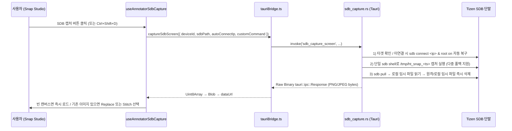

# 📸 Snap Studio 원클릭 SDB 단말 스크린샷 캡처 구현 계획서

- **작성일**: 2026-11-21
- **대상 앱**: Snap Studio (`components/ScreenshotAnnotator`) + Tauri Rust Native Core (`src-tauri/src/commands`)
- **목표**: 별도 앱을 늘리지 않고 **Snap Studio 안에서 원클릭(또는 단축키)**으로 `SDB 자동 연결/복구 → 단말 현재 화면 캡처 → Snap Studio 현재 캔버스에 즉시 오픈`까지 3초 컷으로 끝내는 워크플로우 구축.

---

## 1. 핵심 설계 원칙

1. **Zero Friction (1-Click First)**: 평소에는 헤더의 `SDB` 버튼 클릭 1번(또는 빈 화면의 `Capture SDB` 버튼 / `Ctrl+Shift+D`)으로 즉시 연결→캡처→오픈 완료.
2. **Log Extractor와 완벽 공존 & 설정 공유**:
   - `Log Extractor`(`TizenConnectionModal`)가 저장해 둔 `localStorage` 키(`tizen_sdb_path`, `lastSdbDeviceId`)를 그대로 공유.
   - 단발성 `sdb [-s <id>] shell` / `pull` 서브프로세스만 실행하므로, `Log Extractor`에서 실행 중인 실시간 `dlogutil` 스트림(`SDB_SESSION`)을 절대 끊지 않음.
3. **고성능 & Zero-Copy / Zero-Blur**:
   - Rust에서 캡처된 PNG/JPEG 원본 바이트를 **Raw Binary `tauri::ipc::Response`**로 WebView에 직접 전달(IPC Base64 직렬화 0회).
   - 단말 `/tmp/ht_snap_*` 및 PC 로컬 임시 파일은 캡처 직후 즉시 삭제(디스크 누수 0).
   - 모든 팝오버/오버레이는 **Zero-Blur** 원칙 100% 준수.
4. **작은 모듈 분리 (900줄 규칙 준수)**:
   - Rust 캡처 엔진은 `src-tauri/src/commands/sdb_capture.rs`로 독립 분리.
   - 프론트엔드 SDB 상태/캡처 로직은 `useAnnotatorSdbCapture.ts` 훅, 설정 팝오버는 `AnnotatorSdbPopover.tsx`로 분리하여 `ScreenshotAnnotator/index.tsx`(현재 680줄)의 비대화를 방지.

---

## 2. 아키텍처 & 데이터 플로우

---

## 3. 단계별 상세 변경 계획

### Phase 1. Rust Native SDB 캡처 엔진 (`src-tauri/`)

#### [NEW] `src-tauri/src/commands/sdb_capture.rs`
- `stream_sdb.rs`의 공용 헬퍼(`resolve_sdb_bin`, `build_sdb_target_args`, `is_ipv4_target`, `run_sdb_command_with_timeout`)와 `stream_engine.rs`의 `parse_sdb_devices_stdout`을 재사용 (`pub(crate)` 노출).
- `#[tauri::command] pub async fn sdb_capture_screen(...) -> Result<tauri::ipc::Response, String>` 구현:
  1. **자동 연결 & 타겟 해석**:
     - 명시된 `device_id`가 있으면 `sdb -s <id> shell echo READY` (`4s`) 확인.
     - 미응답(`target not found`)이면서 IPv4 타겟(또는 `auto_connect_ip` 존재)이면 자동으로 `sdb connect <ip>` (`8s`) → `sdb -s <ip> root on` (`4s`) → `300ms` 대기 후 재검증.
     - `device_id`가 비어있으면(`Auto-detect`) `sdb devices`에서 온라인 `device`를 자동 탐색; 없으면 저장된 `auto_connect_ip`로 자동 연결 시도.
  2. **단일 쉘 호출 캡처 파이프라인 (다중 Tizen 버전 대응)**:
     - 원격 격리 폴더 `/tmp/ht_snap_<timestamp_ms>` 생성 후 캡처 실행.
     - 사용자 지정 명령(`custom_command`, `{out}` 플레이스홀더 지원)이 있으면 최우선 실행.
     - 기본 자동 폴백 체인 (단일 `sdb shell` 호출 내 순차 시도):
       1. `enlightenment_info -dump_screen` (Tizen EFL/Wayland 표준 — 폴더/기본 경로 생성 파일 탐지)
       2. `scrot <out>`
       3. `screencap -p <out>`
       4. `screenshot <out>`
     - 성공 시 `CAPTURED:<remote_path>` 출력 파싱으로 생성된 실제 이미지 파일 경로를 정확히 특정.
  3. **Pull & Zero-Copy 반환 & 클린업**:
     - `sdb [-s <target>] pull <remote_path> <local_temp_path>` (`12s` 타임아웃).
     - 매직 바이트 검증(PNG / JPEG / WebP / BMP) 후 `tauri::ipc::Response::new(bytes)` 반환.
     - 로컬 임시 파일 즉시 삭제 + 원격 `/tmp/ht_snap_<ts>` 비동기 정리(`rm -rf`).
- Rust 단위 테스트(`#[cfg(test)]`) 포함: 캡처 출력 경로 파서(`parse_captured_remote_path`), 이미지 매직 바이트 검증(`detect_image_mime`), 쉘 명령 빌더 테스트.

#### [MODIFY] `src-tauri/src/commands/mod.rs`, `src-tauri/src/commands/stream_sdb.rs`, `src-tauri/src/lib.rs`
- `stream_sdb.rs`의 `run_sdb_command_with_timeout`을 `pub(crate)`로 승격.
- `mod.rs`에 `pub mod sdb_capture;` 등록, `lib.rs`의 `invoke_handler`에 `sdb_capture::sdb_capture_screen` 등록.

---

### Phase 2. 프론트엔드 Tauri Bridge 연동 (`utils/`)

#### [MODIFY] `utils/tauriBridge.ts`
- `listSdbDevices(sdbPath?: string)`: 기존 Rust 커맨드 `native_list_sdb_devices` 직접 호출.
- `captureSdbScreen(options)`: `invoke('sdb_capture_screen', ...)` 호출 후 `toUint8Array()`로 Zero-Copy 바이너리 수신 + 매직 바이트 기반 MIME(`image/png` 등) 판별.

#### [NEW] `utils/annotatorSdbSettings.ts`
- SDB 캡처 전용 경량 설정 영구 저장 헬퍼 (`localStorage`):
  - `tizen_sdb_path` / `lastSdbDeviceId`: `TizenConnectionModal`과 동일 키 공유.
  - `snap_studio_sdb_ip`: 빠른 원격 IP 입력값 (예: `192.168.250.250`).
  - `snap_studio_sdb_behavior`: `'replace' | 'ask'` (기존 이미지가 열려있을 때 바로 교체할지, Stitch 모달을 띄울지 선택 — 기본 `'ask'`).
  - `snap_studio_sdb_delay_sec`: `0 | 3` (즉시 캡처 vs 3초 지연 캡처).
  - `snap_studio_sdb_custom_cmd`: 단말 특수 캡처 명령어 오버라이드 (비어있으면 자동 감지).

---

### Phase 3. Snap Studio UI & 훅 통합 (`components/ScreenshotAnnotator/`)

#### [NEW] `components/ScreenshotAnnotator/hooks/useAnnotatorSdbCapture.ts`
- SDB 장치 목록 스캔(`refreshDevices`), 3초 카운트다운 지연 타이머(취소 가능), `captureFromSdb()` 비동기 오케스트레이션 전담.
- 중복 클릭 방지(`isCapturing` 가드), 단계별 상태 표시(`Connecting…` / `3s…` / `Capturing…`), 에러 시 친절한 Toast 안내 + 설정 팝오버 자동 오픈 유도.
- 캡처 성공 시:
  - 빈 캔버스이거나 `behavior === 'replace'`이면 `loadNewDocument(...)`로 즉시 현재 캔버스에 열기 (타이틀: `SDB <device> · HH:mm:ss`).
  - 기존 문서가 있고 `behavior === 'ask'`이면 기존 `handleIncomingImage(...)`로 넘겨 **Replace / Side-by-Side / Stack Below / Overlay** 선택 가능!

#### [NEW] `components/ScreenshotAnnotator/components/AnnotatorSdbPopover.tsx`
- 헤더의 SDB 스플릿 버튼 우측 `▾` 클릭 시 열리는 콤팩트 팝오버 (Zero-Blur, `bg-[#0b1120]`, 바깥 클릭/`Esc` 닫힘):
  - **Device 선택 드롭다운** (`Auto-detect` + 스캔된 기기 목록 + `Rescan` 버튼)
  - **Remote IP (선택)** 입력 (USB 미연결 시 자동 `sdb connect`)
  - **SDB Path** 입력 (`Log Extractor`와 자동 동기화)
  - **캡처 옵션 토글**:
    - 기존 이미지 있을 때: `Ask (Stitch/Replace)` vs `Instant Replace`
    - 타이머: `Instant (0s)` vs `Delay (3s)`
  - **Advanced (접이식)**: Custom Capture Command 입력란 (`{out}` 플레이스홀더 안내)

#### [MODIFY] `components/ScreenshotAnnotator/components/AnnotatorHeader.tsx`
- 우측 퀵 액션 영역(`Paste` / `Open` 옆)에 **SDB Capture 스플릿 버튼** 추가:
  - 좌측 메인 영역: 1클릭 즉시 캡처 (캡처 중 스피너 / 3초 카운트다운 숫자 표시).
  - 우측 `▾`: `AnnotatorSdbPopover` 토글.

#### [MODIFY] `components/ScreenshotAnnotator/components/AnnotatorEmptyState.tsx`
- 빈 화면 중앙 버튼 그룹에 **`Capture SDB`** 버튼 추가 (Tauri 환경 노출).

#### [MODIFY] `components/ScreenshotAnnotator/index.tsx`
- `useAnnotatorSdbCapture` 훅 연결 + `Ctrl+Shift+D` (`e.code === 'KeyD'`) 단축키 바인딩 + `AnnotatorSdbPopover` 마운트.

---

## 4. 추가로 같이 넣으면 꿀일 아이디어 (제안)

이번 구현에 기본 반영해 두었거나 옵션으로 바로 켤 수 있는 포인트입니다:
1. **3초 지연 캡처 (`0s / 3s` 토글)** *(계획서 포함)*: 단말 리모컨으로 팝업/포커스를 띄워놓은 채 캡처할 때 손이 모자란 문제를 100% 해결!
2. **연속 캡처 + Stitch 자동 연동** *(계획서 포함)*: 화면 A 캡처 → 단말 조작 → 다시 `SDB` 클릭 → 기존 `Side-by-Side`로 Before/After 1클릭 병합!
3. *(선택)* **캡처 직후 자동 클립보드 복사 토글**: 주석 없이 단말 화면만 바로 메신저에 붙여넣고 싶을 때, Snap Studio에 열면서 동시에 OS 클립보드에도 자동 복사.

---

## 5. 검증 계획 (Verification Plan)

1. **Rust 백엔드 테스트 (`cargo test`)**:
   - `sdb_capture.rs` 내 캡처 경로 파싱, 이미지 매직 바이트 판별, 커스텀 명령 치환, IPv4 자동 복구 타겟 인자 생성 단위 테스트 통과.
2. **프론트엔드 단위 테스트 (`vitest`)**:
   - `annotatorSdbSettings` 로컬 스토리지 동기화(`tizen_sdb_path`, `lastSdbDeviceId`) 테스트.
   - `useAnnotatorSdbCapture` 훅: 캡처 성공(빈 캔버스 즉시 오픈 / 기존 캔버스 `replace` vs `ask` 분기), 중복 호출 방지, 에러 처리, 3초 카운트다운 취소 테스트.
3. **타입 체크 (`tsc --noEmit`) & 성능 체크**:
   - 프로젝트 전체 TS 에러 0건, Zero-Blur 준수, 수정 파일 모두 900줄 미만 유지, `important/APP_MAP.md` 및 `docs/maps/*` 업데이트.
4. **실 단말 수동 확인 (형님 환경)**:
   - USB / 원격 IP 연결 상태에서 Snap Studio `SDB` 1클릭 → 자동 연결 → 현재 화면 캡처 → 캔버스 즉시 로드 확인.
   - `Log Extractor`에서 SDB 실시간 로그 스트리밍 중 Snap Studio `SDB` 캡처 실행 시 로그 스트림이 끊기지 않는지 확인.

---

## ❓ 구현 전 형님께 확인할 딱 1가지

- **형님 단말(Tizen)에서 평소에 화면 캡처할 때 쓰는 정확한 `sdb shell` 명령어**가 있으신가요?
  - 예: `enlightenment_info -dump_screen` / `tizen-screenshot` / 사내 전용 바이너리 등
  - 알려주시면 자동 감지 체인의 **1순위 기본 명령어**로 정확하게 맞춰서 넣겠습니다! (모르시거나 여러 기종 혼용이시면 위 자동 폴백 체인 + 커스텀 명령 오버라이드 구조 그대로 진행합니다!)
